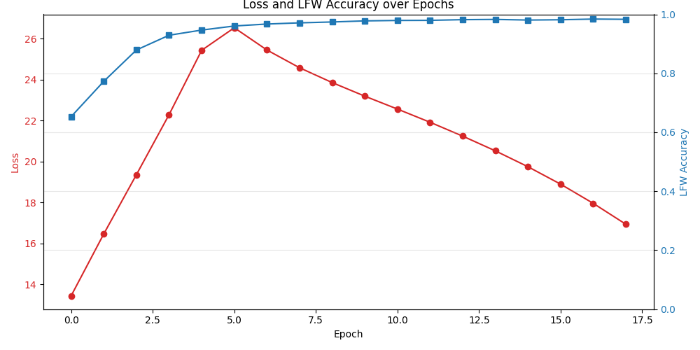

# Tổng hợp Thông số Mô hình `backbone_best.pth`

Dưới đây là chi tiết toàn bộ các thông số liên quan đến mô hình `backbone_best.pth` (ArcFace) trong quá trình huấn luyện gốc.

## 1. Biểu đồ Huấn luyện (Training Curves)



> Lời khuyên:
> Biểu đồ trên cho thấy sự hội tụ của mô hình. Đường màu đỏ thể hiện độ lỗi (Loss) giảm dần qua các Epochs, trong khi đường màu xanh (LFW Accuracy) thể hiện độ chính xác tăng dần và đạt đỉnh 98.4%.

## 2. Thông số ArcFace Chi tiết (Hyperparameters)

Dựa trên bộ khung code, logs và các cấu hình hệ thống, đây là bức tranh toàn cảnh về cách mà mô hình `backbone_best.pth` được tạo ra:

### ⚙️ Cấu trúc Model (Model Architecture)
| Tham số | Giá trị cấu hình | Chi tiết |
| :--- | :--- | :--- |
| **`backbone`** | `iresnet50` | Mạng IResNet 50 lớp (Tổng: 43.6 triệu parameters) |
| **`embedding_size`** | `512` | Số chiều của vector đặc trưng khuôn mặt đầu ra |
| **`dropout`** | `0.4` | Tỷ lệ loại bỏ nơ-ron để chống Overfitting khi train gốc |

### 🎯 Hàm Loss (ArcFace Loss)
| Tham số | Giá trị cấu hình | Chi tiết |
| :--- | :--- | :--- |
| **`scale_s`** | `64.0` | Bán kính của không gian cầu (Hypersphere radius) |
| **`margin_m`** | `0.4` | Góc Margin cộng thêm để ép các khuôn mặt cùng người dồn lại gần nhau hơn |

### 📊 Dữ liệu Huấn luyện (Data)
| Tham số | Giá trị cấu hình | Chi tiết |
| :--- | :--- | :--- |
| **`num_classes`** | `10572` | Tổng số lượng người (ID) khác nhau trong tập train |
| **`dataset_size`** | `494,149` | Tổng số lượng ảnh khuôn mặt |
| **`data_quality`** | `Đã căn chỉnh (Aligned)` | Khuôn mặt được crop 112x112 theo chuẩn CASIA-WebFace / MS1MV2 |

### 🚀 Thuật toán Tối ưu (Optimization & LR)
| Tham số | Giá trị cấu hình | Chi tiết |
| :--- | :--- | :--- |
| **`optimizer`** | `SGD` | Stochastic Gradient Descent |
| **`momentum`** | `0.9` | Động lượng để vượt qua cực tiểu cục bộ |
| **`weight_decay`** | `5e-4` | Phạt L2 (L2 Regularization) để giảm Overfitting |
| **`grad_clip`** | `5.0` | Cắt tỉa gradient (Gradient Clipping) tránh bùng nổ gradient |
| **`base_lr`** | `0.03` | Learning Rate tiêu chuẩn cao nhất |
| **`lr_scheduler`** | `CosineAnnealing` | Tự động uốn cong giảm dần LR theo biểu đồ Cosine |
| **`warmup_epochs`** | `3` | Số epoch khởi động LR từ rất thấp (`1e-4`) lên đỉnh (`0.03`) |

### 🛠 Kỹ thuật Nâng cao (Training Tricks)
| Tham số | Giá trị cấu hình | Chi tiết |
| :--- | :--- | :--- |
| **`margin_warmup_epochs`** | `5` | Tăng dần Margin `m` từ `0` lên `0.4` trong 5 epochs đầu để tránh model bị sốc |
| **`ema_decay`** | `0.999` | Exponential Moving Average. Làm mượt trọng số mô hình |
| **`mixed_precision`** | `True` | Huấn luyện ở định dạng `fp16` (AMP) giúp tăng tốc độ gấp đôi trên RTX 3090 Ti |

### 📈 Chỉ số Đánh giá (Training & Validation Metrics)
*Các chỉ số dưới đây được lấy từ điểm rơi phong độ tốt nhất (Best Checkpoint - Epoch 16):*

| Tham số | Giá trị thực tế | Chi tiết |
| :--- | :--- | :--- |
| **`loss`** | `17.9585` | Giá trị Cross Entropy + ArcFace Margin trung bình |
| **`clean_acc`** | `74.54%` | Độ chính xác phân loại gốc (không có góc phạt Margin) trên tập train |
| **`margin_acc`** | `11.62%` | Độ chính xác phân loại khắt khe (có góc phạt Margin) |
| **`lfw_accuracy`** | `98.40%` | Độ chính xác trên tập ảnh thực tế LFW (Labeled Faces in the Wild) |
| **`agedb_accuracy`** | `87.10%` | Độ chính xác trên tập ảnh khuôn mặt chênh lệch tuổi tác (AgeDB_30) |
| **`cfp_fp_accuracy`**| `88.13%` | Độ chính xác khi nhìn góc nghiêng (Frontal-Profile) |
| **`far` / `frr` / `eer` / `auc`** | *N/A* | (Chỉ tính `Accuracy` và `Best Threshold` trong kịch bản train hiện tại) |

### 🚀 Triển khai thực tế (Deployment)
| Tham số | Chi tiết |
| :--- | :--- |
| **`feature_normalization`** | Bắt buộc phải chuẩn hóa L2 (`F.normalize(features)`) trước khi so sánh |
| **`cosine_similarity`** | Phương pháp đo lường khoảng cách giữa 2 khuôn mặt được khuyên dùng |
| **`threshold`** | Ngưỡng cắt LFW tối ưu là `1.60` (khoảng cách Euclidean sau khi normalize L2) |
| **`inference_latency`** | Tối ưu cực tốt cho GPU nhờ hỗ trợ `TensorFloat-32 (TF32)` trên kiến trúc Ampere |

---
## 3. Phân bổ Tham số (Layer Parameters)
Tổng quan số lượng trọng số tại từng Block của mô hình:
```markdown
- Khối đầu vào (Input)
  ├─ conv1: 1,728 tham số
  ├─ bn1: 128 tham số
  └─ prelu: 64 tham số

- Khối tích chập đặc trưng (Convolutional Blocks)
  ├─ layer1 (3 blocks): 226,752 tham số
  ├─ layer2 (4 blocks): 1,117,824 tham số
  ├─ layer3 (14 blocks): 16,278,272 tham số
  └─ layer4 (3 blocks): 13,118,464 tham số

- Khối đầu ra (Output & Embedding)
  ├─ bn2: 1,024 tham số
  ├─ fc (Linear): 12,845,568 tham số
  └─ features (BatchNorm1d): 1,024 tham số
```
